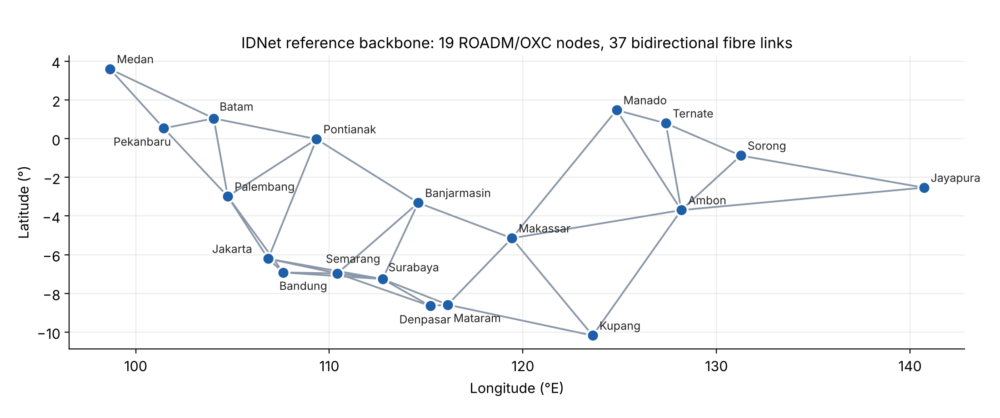
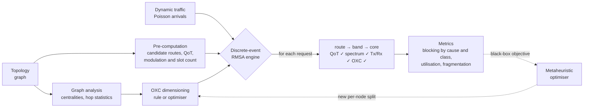
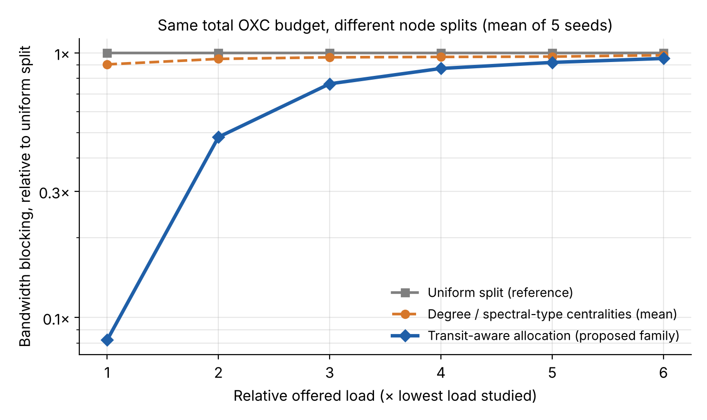
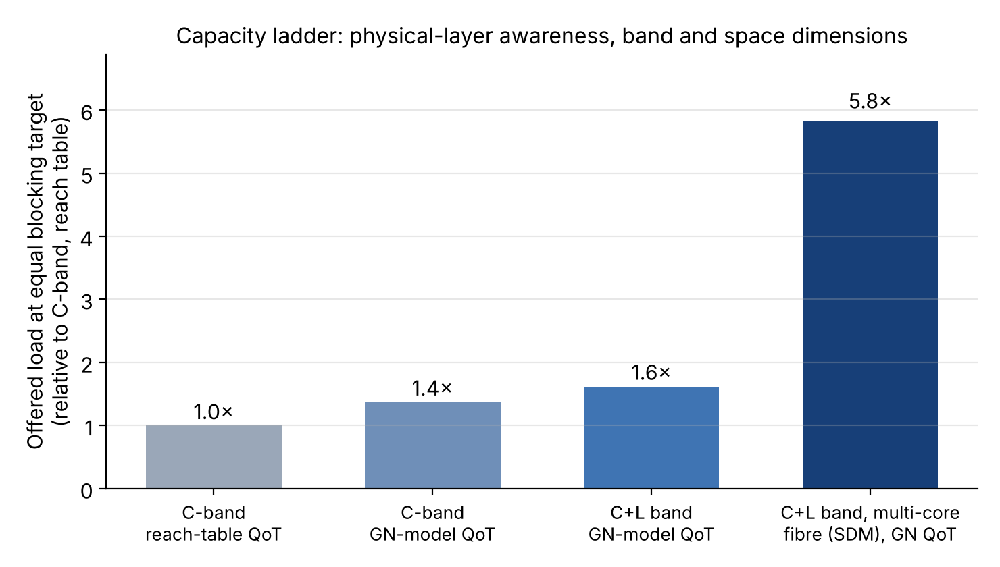
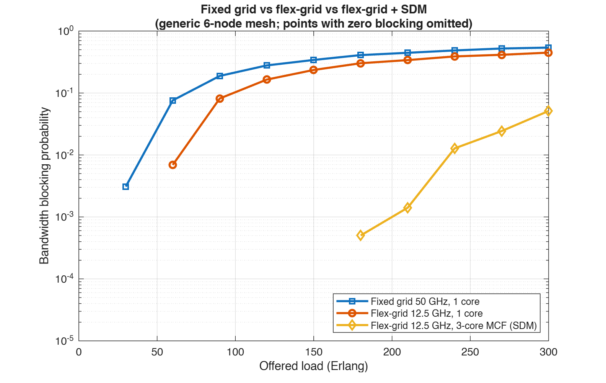

# Flex-Grid and SDM Traffic Route Graph Optimization for Transparent Optical Networks

**Modelling and optimizing how traffic is routed, assigned spectrum and switched across a national
optical backbone built on flexible-grid, multi-band and multi-core (SDM) fibre.**


> **About this repository.** This is the public overview of an ongoing research project. It presents the
> problem, the network model, the research framework and verified qualitative results. The full
> simulation suite, network and traffic data, dimensioning rules, calibrated physical-layer parameters
> and numerical results are **withheld** pending publication. For collaboration, peer review or access,
> contact [ikhlas.sabilly@gmail.com](mailto:ikhlas.sabilly@gmail.com).

---

## The problem

Backbone traffic keeps growing, and operators now have three ways to add capacity to a transparent
(all-optical) network: slice the spectrum more finely (**flex-grid**), light more of the fibre's
spectrum (**multi-band**, C+L), or add parallel spatial channels (**space-division multiplexing**,
multi-core fibre). None of them helps unless the network decides well, for every incoming request:

1. **Which route?** A lightpath stays in the optical domain end to end, so the route fixes its length,
   its signal quality and which nodes must switch it.
2. **Which modulation and how much spectrum?** Longer paths need more robust, less spectrally efficient
   formats, so the route decides the bandwidth the request consumes.
3. **Which spectrum block, on which core?** The block must be contiguous, identical on every link of the
   route and, in a multi-core fibre, on the same core. Poor choices fragment the spectrum and block
   later requests even when total capacity is free.
4. **Where should switching capacity live?** Every node a lightpath crosses spends optical
   cross-connect (OXC) capacity. With a fixed total budget, the per-node split decides which nodes
   become bottlenecks.

This project studies these four decisions jointly on the **Indonesian IDNet backbone** (19 nodes,
37 fibre links spanning Sumatra to Papua). Its archipelago geography gives long, sparse inter-island
corridors that stress reach, spectrum and node capacity at the same time.

<p align="center">
  
  <br><em>The IDNet reference backbone used in the study. Link lengths, node capacities and traffic are withheld.</em>
</p>

## The model

The network is modelled as a **traffic route graph**: nodes are ROADM/OXC sites with finite transceiver
and switching resources, and edges are fibre links whose state is a spectrum × core occupancy matrix.

| Layer | What is modelled |
|---|---|
| **Spectrum** | ITU-T G.694.1 flex-grid in 12.5 GHz slots; contiguity, continuity and core-continuity constraints |
| **Bands and space** | Single C band, or C+L line systems; single-core or multi-core fibre (SDM) |
| **Transceivers** | Bandwidth-variable coherent transceivers; slot count from bit rate, modulation, polarisation, FEC overhead and roll-off |
| **Physical layer (QoT)** | Either an operator-style reach table or a closed-form Gaussian-noise (GN) model with per-band parameters, checked against a pre-FEC BER threshold |
| **Nodes** | Finite add/drop transceiver pools and finite OXC switching capacity, consumed by every node on a lightpath |
| **Traffic** | Dynamic Poisson arrivals with exponential holding times; mixed 100G to 800G demands |



- **Routing, modulation and spectrum assignment (RMSA).** K-shortest-path routing, a state-aware
  re-routing heuristic, several spectrum-assignment policies (First-, Best-, Last- and Random-Fit) and
  path-selection policies that pack spectrum or minimise fragmentation.
- **Physical-layer awareness.** Modulation is chosen per path and per band from its estimated
  generalised SNR, so the same request may need very different spectrum on different routes.
- **Graph-theoretic dimensioning.** Node switching capacity is distributed from the structure of the
  route graph rather than spread evenly.
- **Simulation-in-the-loop optimisation.** Population-based metaheuristics (Grey Wolf and Whale
  optimisers) search the space of per-node splits, using the full network simulation as the objective.
- **Statistical rigour.** Common random numbers across scenarios, multiple seeds with 95 % confidence
  intervals, steady-state metrics after warm-up, and blocking attributed to its cause (spectrum,
  transceiver, OXC, QoT, no route).

## Research framework

The study is a staged simulation in which each stage answers one design question and must pass its own
verification checks before the next begins. [`docs/FRAMEWORK.md`](docs/FRAMEWORK.md) describes the
method in detail.

| Stage | Design question |
|---|---|
| 1. Route graph | What does the topology look like as a graph, and which nodes and corridors carry transit traffic? |
| 2. Transceiver and spectrum model | How many slots does each demand need for a given modulation, transceiver and grid? |
| 3. Physical layer | Which modulation can each route support, and how conservative is a fixed reach table? |
| 4. RMSA | Which routing and spectrum policy blocks the least traffic, and when does the policy stop mattering? |
| 5. Node dimensioning | How should a fixed OXC budget be split across nodes? |
| 6. Optimisation | How far is the best graph-based rule from a simulation-optimised split, and what does the optimum resemble? |
| 7. Technology scaling | How much load can multi-band and multi-core (SDM) fibre add at equal blocking? |

## Verified results (qualitative)

Acceptance criteria were fixed before the experiments, encoded as automated tests, and met. Load sweeps
use five seeds per point with 95 % confidence intervals.

- **Node dimensioning matters as much as routing.** With the *same* total OXC budget, a transit-aware
  allocation lowers bandwidth blocking by **about an order of magnitude** at the lowest load studied compared
  with an even split, and stays ahead at every load. Degree- and spectral-type graph measures are no better than splitting evenly.
- **The best routing policy depends on load.** At low load, a state-aware re-routing heuristic blocks
  about a third less traffic than static K-shortest-path routing. At high load the ranking reverses
  slightly, and the gaps between routing policies become small compared with the effect of node
  dimensioning (paired tests over common random numbers).
- **Physical-layer modelling changes the answer.** Replacing a conservative reach table with a GN-model
  QoT estimate lets the network carry noticeably more load at the same blocking. The physical-layer
  assumption is as consequential as the choice of routing algorithm.
- **SDM is the strongest capacity lever.** Multi-band fibre adds a moderate gain; multi-core fibre, with
  node resources scaled accordingly, raises the sustainable load several-fold.
- **Bottlenecks are geographic.** Under forward-looking traffic, blocking concentrates on long
  inter-island corridors and on long-haul, high-rate demands, which points to targeted rather than
  network-wide upgrades.
- **Engineering quality.** Nine automated regression tests pass in MATLAB R2026a, including
  reproduction of the earlier model to ten significant digits and graph measures that match MATLAB
  reference implementations to numerical precision. A full 10 000-request simulation takes seconds,
  which makes multi-seed sweeps and simulation-in-the-loop optimisation practical.

<p align="center">
  
  <br><em>Splitting the same OXC budget differently. Blocking is shown relative to an even split and load relative to the lowest load studied; absolute values are withheld.</em>
</p>

<p align="center">
  
  <br><em>Offered load sustainable at an equal blocking target, relative to a C-band system with reach-table QoT. The multi-core case scales node resources with the number of cores.</em>
</p>

## Runnable demo

[`demo/demo_flexgrid_sdm_blocking.m`](demo/demo_flexgrid_sdm_blocking.m) reproduces, on a generic
6-node mesh, the idea at the heart of the study: **why spectrum granularity and spatial channels change
blocking in a transparent network.** It compares a 50 GHz fixed grid, a 12.5 GHz flex-grid and a
flex-grid over 3-core fibre, all fed with identical traffic. It uses base MATLAB or GNU Octave only (the
figure was produced in MATLAB R2026a), and
its topology, traffic and rules are generic, not those of the study.

```matlab
cd demo
demo_flexgrid_sdm_blocking
```

<p align="center">
  
</p>

A fixed grid rounds every demand up to whole 50 GHz channels and wastes spectrum; flex-grid allocates
only what each demand needs. Adding cores multiplies the spectrum, but core continuity means a
lightpath still needs one block free on the same core along its whole route.

## What is public and what is withheld

| Public in this repository | Withheld (available on request) |
|---|---|
| Problem statement and network model | Full MATLAB simulation suite and regression tests |
| Research framework and design questions | Link lengths, traffic matrices and request lists |
| Qualitative, verified outcomes | OXC dimensioning model and allocation weights |
| Normalised figures | Calibrated physical-layer and transceiver parameters |
| Generic educational demo | RMSA heuristics, optimiser settings and training protocol |
| | Absolute blocking results, sweep data and technical report |

## Repository structure

```
.
├── README.md
├── LICENSE                          All rights reserved (see below)
├── CITATION.cff                     How to cite this work
├── docs/
│   ├── FRAMEWORK.md                 Research method and design questions
│   └── figures/                     Public, normalised figures
└── demo/
    └── demo_flexgrid_sdm_blocking.m Generic, self-contained demonstration
```

## Citation

If this work informs your research, please cite it using the metadata in [`CITATION.cff`](CITATION.cff)
(GitHub shows a **Cite this repository** button), or:

> I. Sabilly, *Modelling and Optimization of Traffic Route Graph Based on Flex-Grid and Space-Division
> Multiplexing (SDM) in Modern Optical Communication Systems (Transparent Optical Networks)*, research
> repository, 2026.

## Contact

Interested in collaboration, peer review, or access to the full simulation and results?

- **Email:** [ikhlas.sabilly@gmail.com](mailto:ikhlas.sabilly@gmail.com)
- **GitHub:** open an [issue](../../issues) in this repository

Please describe your affiliation and intended use.

## License

Copyright © 2026 Ikhlas Sabilly. **All rights reserved.** You may view this repository on GitHub. Copying,
modifying, redistributing or using its contents, including the figures and demo code, requires prior
written permission. See [`LICENSE`](LICENSE).
